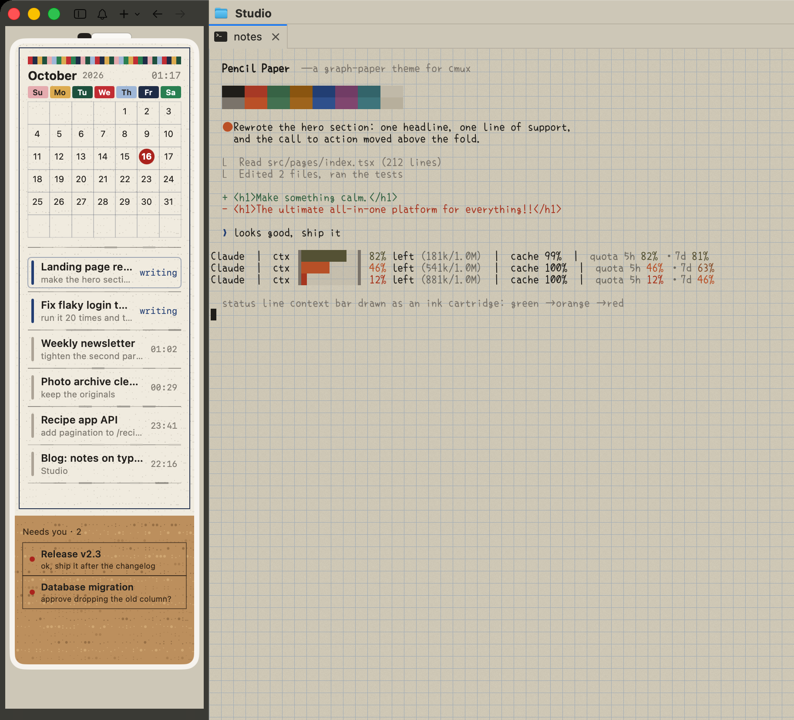
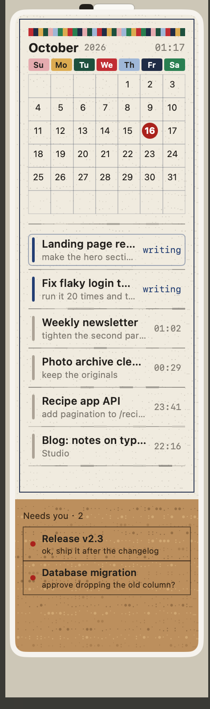

# Pencil Paper for cmux

A calm, paper-like setup for [cmux](https://github.com/manaflow-ai/cmux): a warm graph-paper terminal theme with a handwritten monospace font, and a whiteboard-calendar custom sidebar.



**What's inside**

| | |
|---|---|
| `theme/Pencil Paper` | Ghostty theme: muted paper background, graphite text, ink-colored accents, no neon |
| `theme/pencil-paper-grid.png` | Tiled background: 14pt blue grid squares with faint paper grain |
| `theme/make-grid.py` | Regenerates the background tile (change paper color, line color, square size) |
| `sidebar/desk.js` | Custom sidebar: month calendar, sessions ruled off with pencil lines, a cork strip pinning the sessions that need you |
| `ghostty/config.snippet` | Optional: keep CJK text in the handwritten font too |



**The sidebar**

- A white-framed board with a marker resting on top and a striped binding across the calendar.
- This month's calendar with colored weekday tabs; today is circled in red.
- Your sessions, newest activity first. Sessions that are working show a blue bar and "writing"; the rest show when they last talked. Each one is ruled off with a hand-drawn pencil line.
- A cork strip at the bottom pins every session that is waiting on you.
- Click any row to jump to that session.

It is plain cmux custom-sidebar JavaScript: live data, no network, no files. Set `DEMO = true` at the top to preview it with made-up sessions.

<br clear="right">

## Install

1. **Font** — download `XiaolaiMono-Regular.ttf` from the [kose-font releases](https://github.com/lxgw/kose-font/releases) (OFL-1.1) and install it (double-click, or copy to `~/Library/Fonts`). Prefer your own font? Delete the two `font-` lines in the theme.

2. **Theme**

   ```sh
   mkdir -p ~/.config/ghostty/themes
   cp "theme/Pencil Paper" ~/.config/ghostty/themes/
   cp theme/pencil-paper-grid.png ~/.config/ghostty/
   ```

   Open `~/.config/ghostty/themes/Pencil Paper` and replace `YOU` in the `background-image` line with your macOS user name (use an absolute path). Then:

   ```sh
   cmux themes set "Pencil Paper"
   ```

   cmux keeps an already-loaded background image across `cmux reload-config`; restart cmux if the grid does not show up.

3. **Sidebar**

   ```sh
   mkdir -p ~/.config/cmux/sidebars
   cp sidebar/desk.js ~/.config/cmux/sidebars/
   cmux sidebar select desk
   ```

   Or right-click the sidebar toggle button and pick **desk**. Switch back from the same menu.

4. **Optional: CJK text** — cmux maps CJK characters to its own fallback font, which wins over the theme. Add the line from `ghostty/config.snippet` to `~/.config/ghostty/config` to hand CJK back to the theme.

## Using it with Claude Code

Run `/theme` in Claude Code and pick **Light mode (ANSI colors only)**. Claude Code then draws every color from the theme's 16-color palette, which is tuned for it: graphite text, an orange Claude, ink-blue prompts, muted green and red diffs. The other Claude Code themes use their own fixed colors, which can be hard to read on paper.

The ink-cartridge context bar in the screenshot comes from a personal Claude Code status line script and is not part of this package.

## Notes and limits

- Custom sidebars can only use system fonts and shapes: no custom fonts, no images, no gradients. The paper grain, pencil lines and cork are built from shapes and faint dot characters.
- The sidebar shows up to 9 sessions so the cork strip stays in view, and up to 6 pinned ones. Change the `.slice(...)` numbers in `desk.js` if you want more.
- Tested on cmux 0.65.1, macOS 26.5.

## Credits

- [Xiaolai / Xiaolai Mono](https://github.com/lxgw/kose-font) by lxgw, SIL Open Font License 1.1.
- The theme and sidebar in this repository are MIT licensed.
